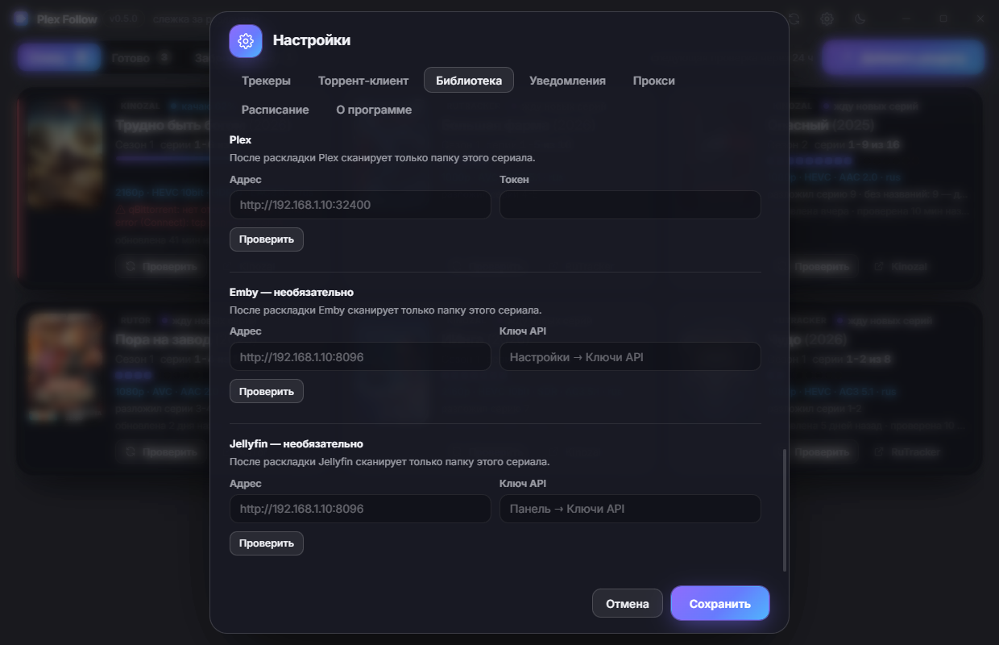
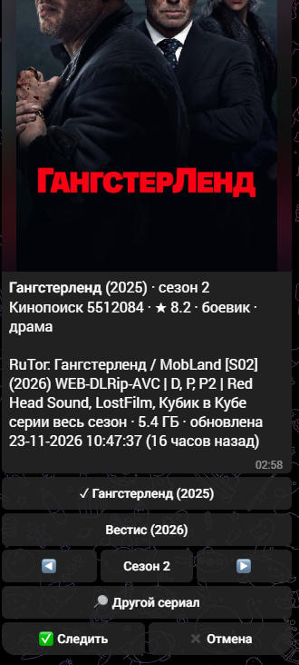
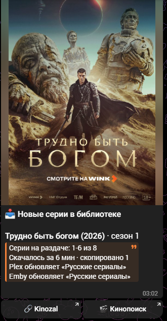
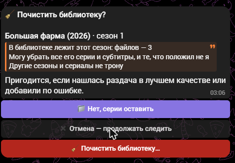

<div align="center">


# Plex Follow

**Следит за раздачами сериалов и сама докачивает новые серии в Plex, Emby и Jellyfin**

[](https://github.com/MrJosu/plex-follow-releases/releases/latest)
[](https://github.com/MrJosu/plex-follow-releases/releases)


### [⬇ Скачать PlexFollow-Setup.exe](https://github.com/MrJosu/plex-follow-releases/releases/latest/download/PlexFollow-Setup.exe)

</div>

<p align="center"></p>

---

Вы добавляете ссылку на раздачу — программа следит именно за ней. Когда в раздаче появляются новые серии,
Plex Follow отдаёт обновлённый торрент вашему торрент-клиенту **в ту же папку**: скачанное проверяется,
докачивается только новое. Готовые серии раскладываются в библиотеку Plex с правильными именами,
Plex, Emby и Jellyfin обновляют сериал, а вам приходит сообщение в Telegram.

```
Сериал (2024) kp-1234567
└── Season 2
    ├── Сериал - S02E08 - Название серии.mkv
    └── Сериал - S02E09 - Название серии.mkv
```

## Что умеет

| | |
|---|---|
| 📡 **Трекеры** | Kinozal, RuTracker, RuTor. Kinozal и RuTracker открываются в окне программы: вы сами проходите проверку Cloudflare и входите в аккаунт. Пароль вводится на сайте — программа его не видит и не хранит. |
| ⬇️ **Торрент-клиенты** | qBittorrent, Transmission, Deluge, rTorrent. Скорость и остаток закачки видны прямо в программе. |
| 🗂 **Раскладка в библиотеку** | Сериал и названия серий берутся с Кинопоиска, а чего там ещё нет — с TVmaze. Шаблоны имён настраиваются. Оригинал остаётся на раздаче. |
| 🤖 **Бот в Telegram** | Пришлите боту ссылку на раздачу — он покажет сериал и кнопку «Следить». `/list` — за чем слежу, `/check` — проверить сейчас, `/stop` — перестать следить, `/undo` — отменить раскладку. |
| ↩️ **Отмена раскладки** | Сериал опознан неверно? Одна кнопка убирает из библиотеки то, что положила программа; скачанное остаётся в загрузках. Потом — «Разложить заново». |
| 🧹 **Чистка при отмене** | Перестаёте следить — программа скажет, что осталось в библиотеке, и предложит убрать торрент, скачанное и серии этого сезона. Удобно, когда нашлась раздача в лучшем качестве. |
| 🌙 **Работа в фоне** | Живёт в трее, запускается вместе с Windows, может будить компьютер к следующей проверке и не даёт ему уснуть, пока идёт работа. |
| 🔄 **Автообновление** | Новая версия ставится сама. Обновления подписаны: чужой файл программа не установит. |

<table>
<tr>
<td width="50%"></td>
<td width="50%"></td>
</tr>
<tr>
<td align="center"><sub>Трекеры открываются прямо в окне программы</sub></td>
<td align="center"><sub>Plex, Emby и Jellyfin — можно все три сразу</sub></td>
</tr>
</table>

Раздачи разложены по четырём вкладкам:

- **Слежу** — ждём новых серий или докачиваем;
- **Готово** — вышли все серии, всё разложено;
- **Заброшенные** — раздача давно не обновлялась (по умолчанию 14 дней), а серий ещё не все. Обновится — вернётся в «Слежу»;
- **Архив** — раздачи, за которыми вы перестали следить, и давно заброшенные. Отсюда их можно вернуть одной кнопкой.

## Бот в Telegram

Пришлите боту ссылку на раздачу — он найдёт сериал на Кинопоиске и покажет карточку с постером. Кнопка «Следить» — и дальше
о каждой новой серии бот напишет сам: такой же карточкой, со ссылками на раздачу и Кинопоиск. Отвечает бот только вашему чату.

<table>
<tr>
<td width="31%" valign="top"></td>
<td width="31%" valign="top"></td>
<td width="38%" valign="top"></td>
</tr>
<tr>
<td align="center"><sub>Ссылка → карточка сериала</sub></td>
<td align="center"><sub>Новые серии уже в библиотеке</sub></td>
<td align="center"><sub><code>/stop</code>: всё, что удаляет файлы, — красным, последним и с повторным вопросом</sub></td>
</tr>
</table>

Команды: `/list` — за чем слежу, `/check` — проверить сейчас, `/stop` — перестать следить (раздача уйдёт в архив, под сообщением —
кнопка «Вернуть»), `/undo` — отменить раскладку. Меню команд и описание бот настраивает себе сам.

## Как начать

1. Скачайте и запустите [PlexFollow-Setup.exe](https://github.com/MrJosu/plex-follow-releases/releases/latest/download/PlexFollow-Setup.exe).
   Ставится для текущего пользователя, права администратора не нужны.
2. В настройках укажите торрент-клиент, папку загрузок и папки библиотеки Plex.
3. Откройте нужный трекер в окне программы (Настройки → Трекеры) и войдите в аккаунт.
4. Добавьте ссылку на раздачу — дальше программа всё делает сама.

> [!NOTE]
> При первом запуске Windows может показать предупреждение SmartScreen: у установщика нет платной подписи издателя.
> Нажмите «Подробнее» → «Выполнить в любом случае».

## Что понадобится

| Что | Зачем | Обязательно |
|---|---|:---:|
| Windows 10 или 11 | больше ничего ставить не нужно | да |
| Торрент-клиент с веб-интерфейсом | качает раздачи | да |
| Доступ к папке загрузок и к папкам библиотеки | программа копирует и переименовывает серии | да |
| Ключ [Кинопоиска](https://kinopoiskapiunofficial.tech) (бесплатный) | названия серий и номер сериала | желательно |
| Plex, Emby или Jellyfin | обновляют папку сериала после раскладки; можно все три сразу | нет |
| Бот в Telegram | уведомления и добавление раздач с телефона | нет |
| FlareSolverr, Prowlarr | запасной путь к Kinozal и RuTracker | нет |

Программа проверяет раздачи, пока запущена — в окне или в трее.

## Вместе с Plex Renamer

[Plex Renamer](https://github.com/MrJosu/plex-renamer-releases) — та же раскладка вручную: открыли папку со скачанным сезоном,
проверили и нажали «Переименовать». Пригодится для того, что скачано не через слежку.

## Про этот репозиторий

Здесь лежат только готовые установщики и файл `latest.json`, по которому программа узнаёт о новой версии.
Исходный код — в закрытом репозитории. Список изменений каждой версии — на странице
[релизов](https://github.com/MrJosu/plex-follow-releases/releases).

Программа сделана для себя и выложена как есть, без гарантий.
