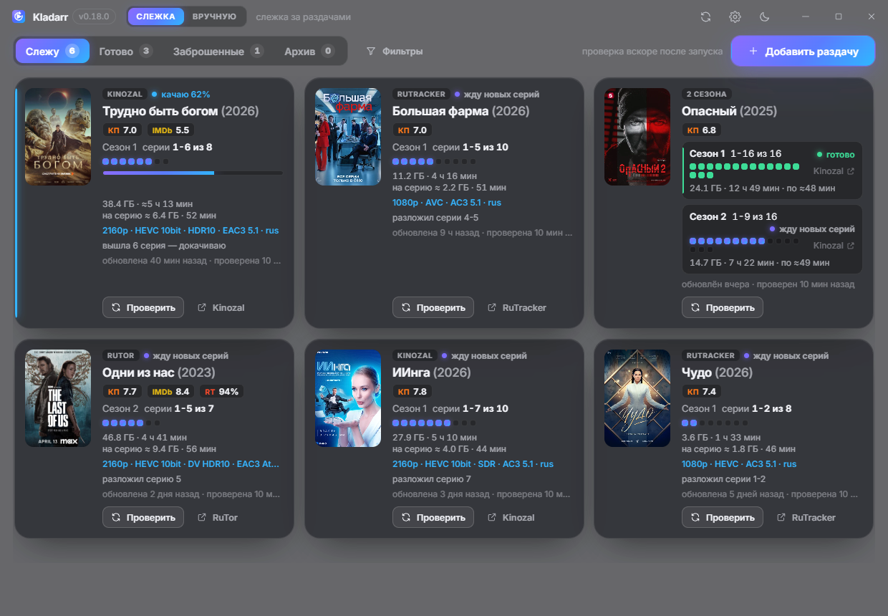
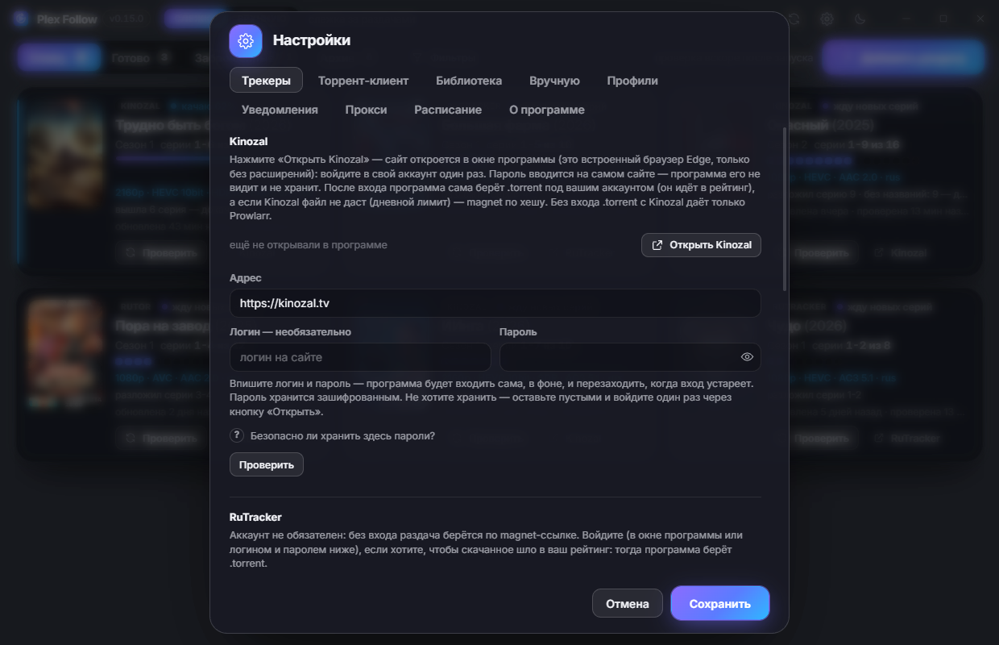
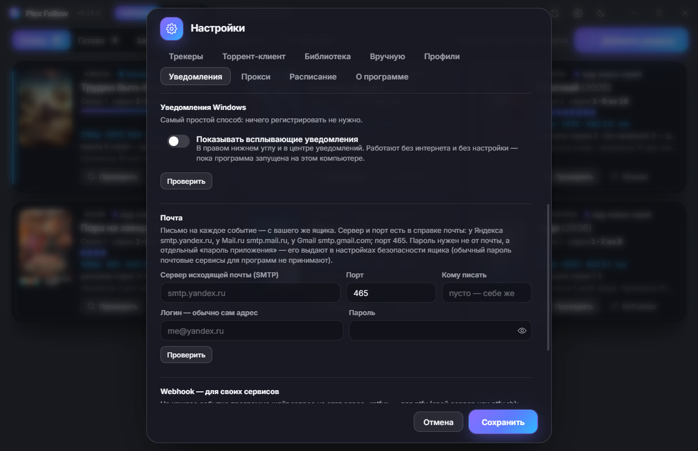
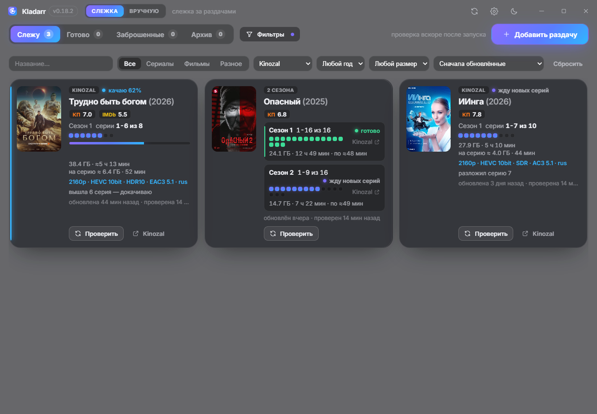
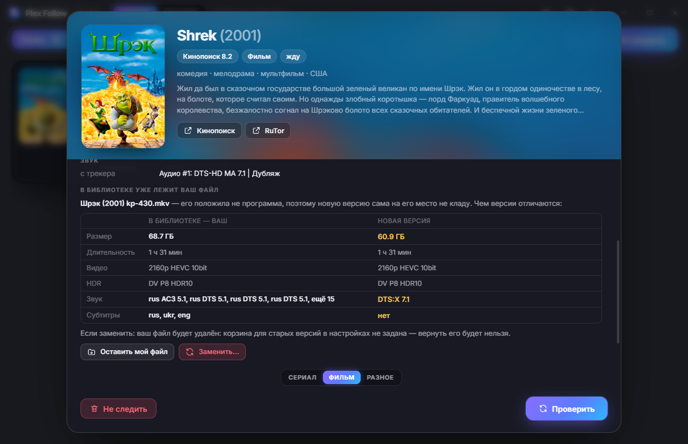
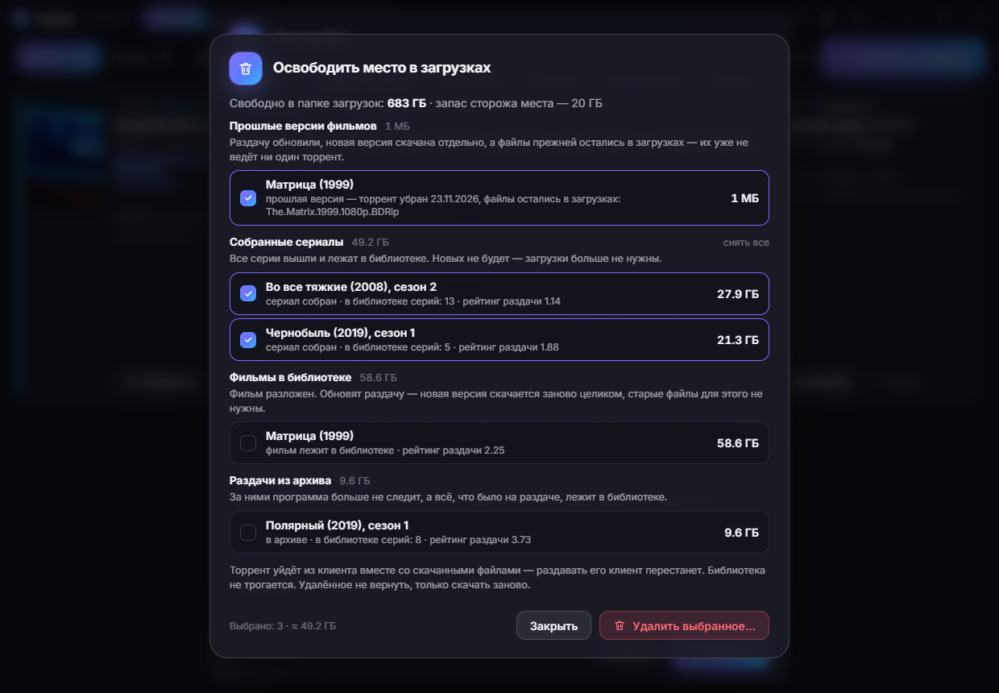
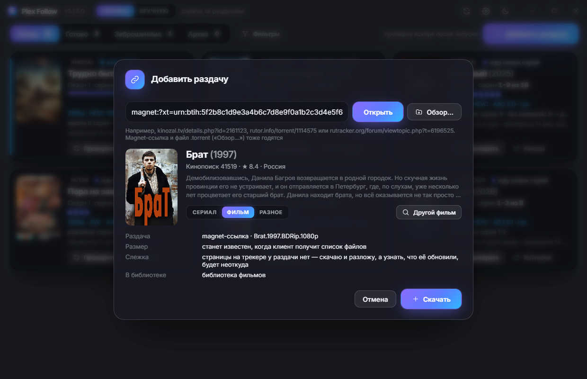
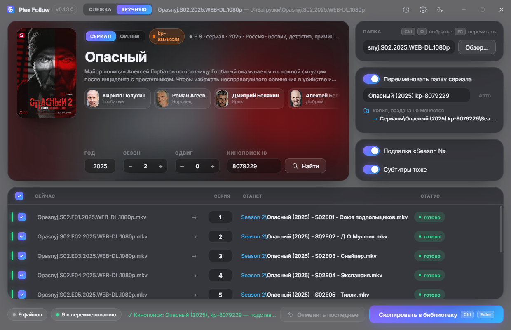
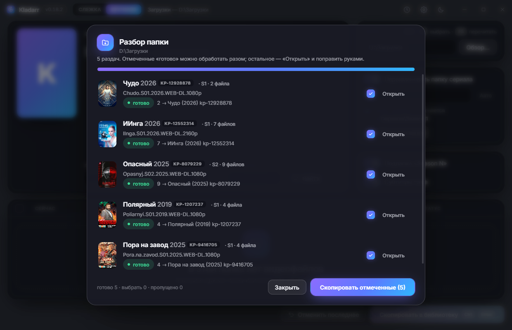

<div align="center">


# Kladarr

**Следит за раздачами сериалов и фильмов: сама докачивает новое и раскладывает в Plex, Emby и Jellyfin**

<sub>Раньше программа называлась Plex Follow. Установленный Plex Follow обновится сам и станет Kladarr — настройки, раздачи и вход на трекеры сохранятся.</sub>

[](https://github.com/MrJosu/kladarr-releases/releases/latest)
[](https://github.com/MrJosu/kladarr-releases/releases)


### [⬇ Скачать Kladarr-Setup.exe](https://github.com/MrJosu/kladarr-releases/releases/latest/download/Kladarr-Setup.exe)

</div>

<p align="center"></p>

---

Вы добавляете ссылку на раздачу — программа следит именно за ней. Когда в раздаче появляются новые серии,
Kladarr отдаёт обновлённый торрент вашему торрент-клиенту **в ту же папку**: скачанное проверяется,
докачивается только новое. Готовые серии раскладываются в библиотеку Plex с правильными именами,
Plex, Emby и Jellyfin обновляют сериал, а вам приходит сообщение в Telegram.

```
Сериал (2024) kp-1234567
└── Season 2
    ├── Сериал - S02E08 - Название серии.mkv
    └── Сериал - S02E09 - Название серии.mkv
```

Нет ссылки на страницу раздачи — подойдут [magnet-ссылка или файл .torrent](#magnet-и-файл-torrent).

В программе два режима — переключатель в заголовке окна. **Слежка** всё делает сама. **Вручную** — для того, что скачано
не через слежку: открыли папку, проверили имена и положили в библиотеку. Подробнее — [ниже](#режим-вручную).

## Что умеет

| | |
|---|---|
| 📡 **Трекеры** | Kinozal, RuTracker, RuTor. Kinozal и RuTracker открываются в окне программы: вы сами проходите проверку Cloudflare и входите в аккаунт на сайте — так программа пароль не видит и не хранит. Удобнее иначе — впишите логин и пароль в настройки: программа будет входить сама, а пароль сохранит зашифрованным. Если сайт при входе просит проверку, программа покажет окно: нажмите в нём галочку — логин и пароль она впишет сама. |
| 🧲 **Magnet и .torrent** | Вместо ссылки на раздачу — magnet или файл .torrent. Если в файле записана страница раздачи, программа следит за ней как обычно; если нет — скачает и разложит в библиотеку один раз. Файл .torrent можно просто перетащить на окно программы. |
| ⬇️ **Торрент-клиенты** | qBittorrent, Transmission, Deluge, rTorrent. Скорость и остаток закачки видны прямо в программе. Папку загрузок программа находит сама — достаточно вставить путь из Проводника. |
| 🃏 **Карточки** | У каждой раздачи — серии кружками, размер и длительность: всего и в среднем на серию (из самих файлов — MKV, MP4, AVI, TS). Сезоны одного сериала собраны в одну карточку, у каждого сезона своя строка. |
| ⭐ **Оценки** | На карточке — Кинопоиск, IMDb и Rotten Tomatoes. По желанию — ещё зрители Rotten Tomatoes, Metacritic, TVmaze и критики России. Лишнее выключается в настройках. |
| 🗂 **Раскладка в библиотеку** | Сериал и названия серий берутся с Кинопоиска, а чего там ещё нет — с TVmaze. Шаблоны имён настраиваются. Оригинал остаётся на раздаче. |
| 🎬 **Фильмы** | Ссылка на раздачу фильма — и он в библиотеке. Раздачу заменили версией получше — программа докачает её и заменит фильм. Что будет с прежней версией, решаете вы. Задайте в настройках папку корзины — версия уйдёт туда: программа спросит, оставить её или удалить, либо подержит заданное число дней, а до тех пор её можно вернуть. Не зададите — прежняя версия просто удаляется. А файл, который положили в библиотеку вы сами, программа без спроса не тронет — [подробнее](#если-фильм-уже-лежит-в-библиотеке). |
| 📦 **«Разное»** | Игра, программа, что угодно: за такой раздачей программа только следит и докачивает обновления — без Кинопоиска, переименований и раскладки. Можно в отдельную папку; уже скачанное переносится в другую папку одной кнопкой. |
| 🤖 **Бот в Telegram** | Пришлите боту ссылку на раздачу или magnet — он покажет сериал и кнопку «Следить». `/list` — за чем слежу, `/check` — проверить сейчас, `/stop` — перестать следить, `/undo` — отменить раскладку. |
| 🔔 **Уведомления** | Не только Telegram: всплывающие уведомления Windows, почта и webhook — для ntfy, Gotify, Home Assistant и своих скриптов. Каждый способ включается отдельно. |
| 💾 **Сторож места** | Закачка не начнётся, если после неё в папке загрузок останется меньше запаса (по умолчанию 20 ГБ). Программа напишет об этом, сама ничего не удалит и продолжит, когда место появится. |
| 🧹 **Освобождение места** | Одна кнопка показывает, что в загрузках уже лежит в библиотеке и только занимает место: собранные сериалы, фильмы, прошлые версии фильмов. Удаляется только то, что вы отметите, — [подробнее](#освобождение-места). |
| ↩️ **Отмена раскладки** | Сериал опознан неверно? Одна кнопка убирает из библиотеки то, что положила программа; скачанное остаётся в загрузках. Потом — «Разложить заново». |
| 🔀 **Смена вида раздачи** | Добавили сериал как фильм или наоборот? Переключатель «Сериал / Фильм / Разное» в окне раздачи: скачанное остаётся на месте, программа разложит его заново — уже правильно. |
| 🗑 **Чистка при отмене** | Перестаёте следить — программа скажет, что осталось в библиотеке, и предложит убрать торрент, скачанное и серии этого сезона. Удобно, когда нашлась раздача в лучшем качестве. |
| ✋ **Режим «Вручную»** | Папка со скачанным сезоном или фильмом — в библиотеку за пару щелчков: программа узнаёт сериал по имени раздачи, даже если оно написано латиницей, расставляет номера и названия серий. С отменой и историей операций. |
| 🏷 **Профили** | Свои правила для отдельных раздач: другой торрент-клиент, оригинальные или русские названия, своя папка библиотеки. Выбирается при добавлении — в окне или кнопкой в боте. |
| 🔎 **Фильтры** | Раздач много? Поиск по названию, сериалы, фильмы или «Разное», трекер, год, размер и порядок списка. |
| 🌐 **Прокси** | HTTP или SOCKS5 для трекеров и Telegram, если сайт не открывается. Прокси вашего VPN-клиента найдёт кнопка «Найти локальный прокси». |
| 🔐 **Пароли под защитой** | Пароли, ключи и токены лежат в файле настроек зашифрованными средствами Windows и не попадают в журнал программы. |
| 🌙 **Работа в фоне** | Живёт в трее, запускается вместе с Windows, может будить компьютер к следующей проверке и не даёт ему уснуть, пока идёт работа. |
| 🔄 **Автообновление** | О новой версии программа сообщает сама и ставит её по одной кнопке. Обновления подписаны: чужой файл программа не установит. |

<table>
<tr>
<td width="50%"></td>
<td width="50%"></td>
</tr>
<tr>
<td align="center"><sub>Трекеры: войти в окне программы или вписать логин и пароль</sub></td>
<td align="center"><sub>Старая версия фильма — в свою папку корзины или сразу удалять; Plex, Emby и Jellyfin — можно все три сразу</sub></td>
</tr>
<tr>
<td width="50%"></td>
<td width="50%"></td>
</tr>
<tr>
<td align="center"><sub>Уведомления: Telegram, Windows, почта, webhook</sub></td>
<td align="center"><sub>Фильтры: название, вид, трекер, год, размер, порядок</sub></td>
</tr>
</table>

Раздачи разложены по четырём вкладкам:

- **Слежу** — ждём новых серий или докачиваем;
- **Готово** — вышли все серии, всё разложено;
- **Заброшенные** — раздача давно не обновлялась (по умолчанию 14 дней), а серий ещё не все. Обновится — вернётся в «Слежу»;
- **Архив** — раздачи, за которыми вы перестали следить, и давно заброшенные. Отсюда их можно вернуть одной кнопкой.

Если что-то мешает работе прямо сейчас, над карточками появляется плашка: торрент-клиент не отвечает — с каких пор и почему;
мало места в папке загрузок — с кнопкой «Освободить место…».

## Если фильм уже лежит в библиотеке

Бывает, что на месте фильма в библиотеке уже лежит файл, который положили вы сами или другая программа. Такой файл
программа не заменяет — она спрашивает: в окне фильма и в Telegram. Обе версии стоят рядом, различия выделены:
размер, длительность, разрешение и кодек, HDR и профиль Dolby Vision, звук и субтитры. Тут же сказано, что станет
с вашим файлом, если заменить: уйдёт в корзину или удалится, если корзина в настройках не задана.
«Оставить мой файл» — новая версия остаётся в загрузках; «Заменить…» — с повторным вопросом.

<p align="center"></p>

## Освобождение места

Раскладка в библиотеку — это копия: оригинал остаётся в папке загрузок и продолжает раздаваться. Со временем там копится то,
что уже не нужно. Кнопка «Освободить место…» (Настройки → Торрент-клиент → «Папка загрузок») собирает это в один список:

- **собранные сериалы** — все серии вышли и лежат в библиотеке;
- **фильмы**, которые уже в библиотеке;
- **раздачи из архива**, с которых в библиотеке лежит всё;
- **прошлые версии фильмов** — раздачу обновили, новая версия скачалась отдельно, а файлы прежней остались лежать.

У каждой строки — размер и рейтинг раздачи. Вы отмечаете, что убрать; программа переспросит и удалит торрент из клиента вместе
со скачанными файлами. Библиотека не трогается. Сериалы, которые ещё идут, и «Разное» в список не попадают — им загрузки нужны.

<p align="center"></p>

## Magnet и файл .torrent

В окне «Добавить раздачу» годится не только ссылка на страницу раздачи:

- **файл .torrent** — кнопка «Обзор…». Если трекер записал в файл страницу раздачи (так делает, например, RuTor),
  программа встанет на обычную слежку за ней;
- **magnet-ссылка** — в то же поле, что и обычная ссылка. Боту её тоже можно прислать.

Когда страницы раздачи нет, следить не за чем: программа отдаст раздачу торрент-клиенту, дождётся закачки и разложит
в библиотеку — один раз. Что это за сериал или фильм, она поймёт по имени раздачи и списку файлов.

<p align="center"></p>

## Режим «Вручную»

Для того, что скачано не через слежку. Перетащите папку с сезоном или фильмом на окно (или нажмите «Обзор…») — программа
узнает сериал по имени раздачи, даже если оно написано латиницей, найдёт его на Кинопоиске и покажет, как назовёт каждый файл.
Проверили — и одна кнопка кладёт всё в библиотеку.

<p align="center"></p>

- **Что делать с папкой — решаете вы**: положить в библиотеку копию (раздача продолжает раздаваться), перенести или просто
  переименовать на месте.
- **Номера и названия серий** — из имён файлов, с Кинопоиска и TVmaze. Спорные строки подсвечены, любой номер можно поправить руками.
- **Ничего не теряется**: то, что уже лежит в библиотеке, программа покажет и пропустит, а заменяемую версию сохранит.
  «Отменить последнее» возвращает всё как было, «История» — любую прошлую операцию, если файлы на месте.
- **Разбор всей папки загрузок** (включается в настройках): все раздачи списком — что готово, что выбрать руками — и обработка
  готовых разом.
- **Фильмы** (включается в настройках): `Название (Год) kp-1234567.mkv`.
- Имена — по тем же шаблонам, что у слежки; после раскладки Plex, Emby и Jellyfin так же обновляют папку.

<p align="center"></p>

Торрент-клиент и трекеры этому режиму не нужны — достаточно папки с файлами.

## Бот в Telegram

Пришлите боту ссылку на раздачу или magnet — он найдёт сериал на Кинопоиске и покажет карточку с постером. Кнопка «Следить» —
и дальше о каждой новой серии бот напишет сам: такой же карточкой, со ссылками на раздачу и Кинопоиск. Отвечает бот только вашему чату.

<table>
<tr>
<td width="31%" valign="top"></td>
<td width="31%" valign="top"></td>
<td width="38%" valign="top"></td>
</tr>
<tr>
<td align="center"><sub>Ссылка → карточка сериала</sub></td>
<td align="center"><sub>Новые серии уже в библиотеке</sub></td>
<td align="center"><sub><code>/stop</code>: всё, что удаляет файлы, — красным, последним и с повторным вопросом</sub></td>
</tr>
</table>

Команды: `/list` — за чем слежу, `/check` — проверить сейчас, `/stop` — перестать следить (раздача уйдёт в архив, под сообщением —
кнопка «Вернуть»), `/undo` — отменить раскладку. Меню команд и описание бот настраивает себе сам.

Постер в сообщениях бывает двух видов: небольшой — афиша целиком на квадратной картинке, так по умолчанию, — и во весь размер,
как на снимках выше. Выбирается в настройках, на вкладке «Уведомления». Когда фильм заменён новой версией, а в настройках
задана папка корзины, бот спросит, что делать со старой: оставить в корзине или удалить.

Telegram не обязателен: те же события программа покажет всплывающим уведомлением Windows, пришлёт письмом или отправит
на webhook — ntfy, Gotify, Home Assistant, свой скрипт.

## Как начать

1. Скачайте и запустите [Kladarr-Setup.exe](https://github.com/MrJosu/kladarr-releases/releases/latest/download/Kladarr-Setup.exe).
   Ставится для текущего пользователя, права администратора не нужны.
2. В настройках укажите торрент-клиент, папку загрузок и папки библиотеки Plex.
3. Откройте нужный трекер в окне программы (Настройки → Трекеры) и войдите в аккаунт — или впишите там же логин и пароль.
4. Добавьте раздачу: ссылку на её страницу, magnet или файл .torrent — дальше программа всё делает сама.

Нужен только режим «Вручную»? Хватит первого шага: переключитесь на «Вручную» и перетащите папку на окно.
Папки библиотеки и ключ Кинопоиска — в настройках, вкладка «Библиотека»; что делать с папкой — на вкладке «Вручную».

> [!NOTE]
> При первом запуске Windows может показать предупреждение SmartScreen: у установщика нет платной подписи издателя.
> Нажмите «Подробнее» → «Выполнить в любом случае».

## Что понадобится

| Что | Зачем | Обязательно |
|---|---|:---:|
| Windows 10 или 11 | больше ничего ставить не нужно | да |
| Торрент-клиент с веб-интерфейсом | качает раздачи | для слежки |
| Доступ к папке загрузок и к папкам библиотеки | программа копирует и переименовывает серии | да |
| Ключ [Кинопоиска](https://kinopoiskapiunofficial.tech) (бесплатный) | названия серий и номер сериала | желательно |
| Plex, Emby или Jellyfin | обновляют папку сериала после раскладки; можно все три сразу | нет |
| Бот в Telegram | уведомления и добавление раздач с телефона; уведомлять программа умеет и без него | нет |
| FlareSolverr, Prowlarr | запасной путь к Kinozal и RuTracker | нет |

Программа проверяет раздачи, пока запущена — в окне или в трее.

## Plex Renamer

Режим «Вручную» вырос из отдельной программы — [Plex Renamer](https://github.com/MrJosu/plex-renamer-releases).
Теперь всё, что она умеет, есть здесь, а её настройки и журнал операций Kladarr забирает сам при первом запуске.
Plex Renamer остаётся доступным — если нужен только разбор папок, без слежки.

## Про этот репозиторий

Здесь лежат только готовые установщики и файл `latest.json`, по которому программа узнаёт о новой версии.
Исходный код — в закрытом репозитории. Список изменений каждой версии — на странице
[релизов](https://github.com/MrJosu/kladarr-releases/releases).

Программа сделана для себя и выложена как есть, без гарантий.
